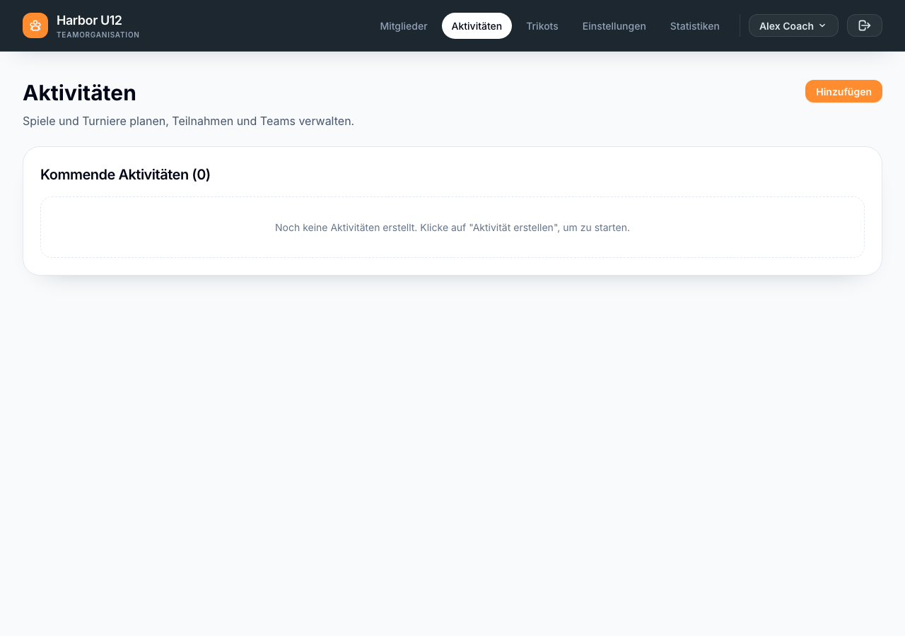
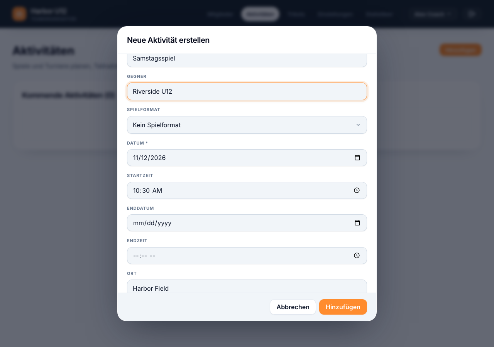
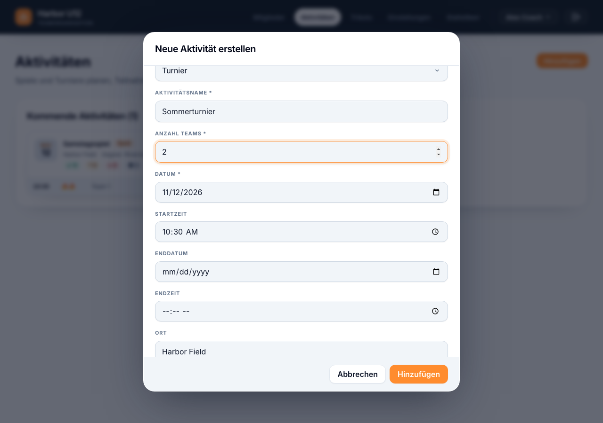
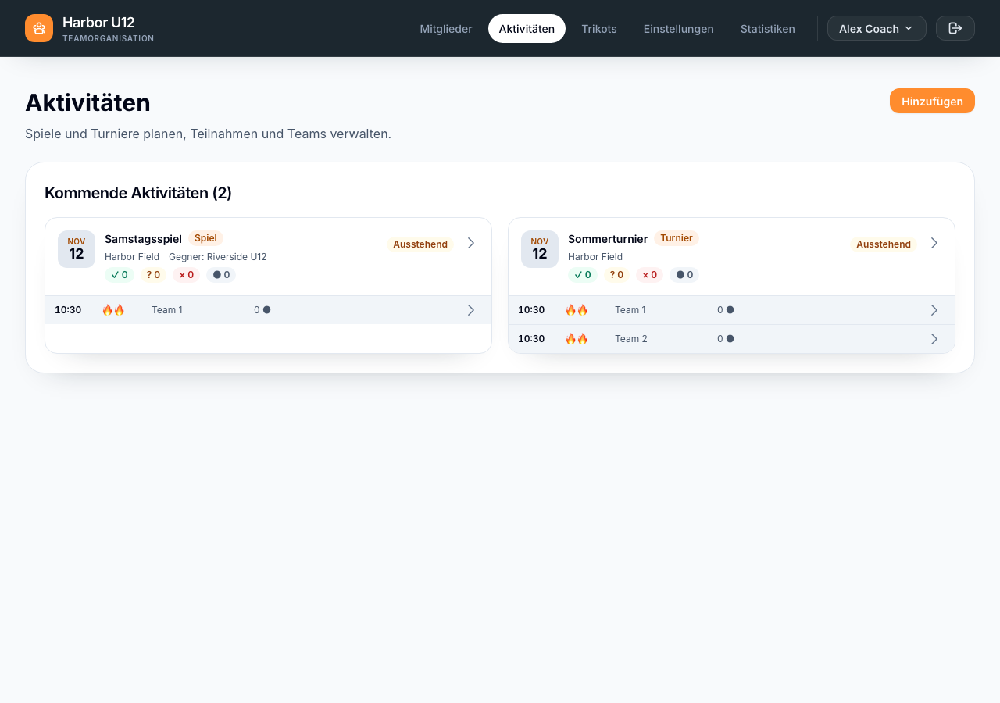

# Aktivität erstellen

Erstelle unter **Aktivitäten** ein Spiel oder ein Turnier. Du musst angemeldet sein, eine Mannschaft ausgewählt haben und die Rolle Admin oder Trainer besitzen. Die manuelle Erstellung ist für Mannschaften ohne Spond-Verknüpfung verfügbar. Erstelle Aktivitäten für eine verknüpfte Mannschaft in Spond und synchronisiere sie anschliessend.

1. Öffne **Aktivitäten** und wähle **Hinzufügen**.
2. Lasse unter **Aktivitätsart** die Option **Spiel** ausgewählt oder wähle **Turnier**.
3. Gib einen Namen, ein Datum und eine Startzeit ein. Du kannst zusätzlich ein Enddatum und eine Endzeit, einen Ort sowie die weiteren Angaben zur gewählten Aktivitätsart eintragen. Bei einem Spiel kannst du den Gegner ergänzen und ein Spielformat auswählen. Bei einem Turnier legst du die Anzahl Teams fest.
4. Lege die minimale und maximale Spielerzahl pro Team fest. Wenn ein Spielformat ausgewählt ist, verwendet das Formular dessen Standardwerte. Andernfalls beträgt die Mindestanzahl zunächst 6 und die Höchstanzahl 9 Spieler pro Team.
5. Wähle **Hinzufügen**. Je nach Datum erscheint die Aktivität unter **Kommende Aktivitäten** oder **Vergangene Aktivitäten**.

*Öffne Aktivitäten und wähle Hinzufügen.*

*Gib Spielplan, Ort und optional den Gegner ein.*

*Wähle Turnier und lege die Anzahl Teams fest.*

Die App erstellt für ein Spiel ein Standardteam und für ein Turnier die angegebene Anzahl Teams. Neue Teams haben zunächst keine ausgewählten Spieler. Einladungen und Spielerzuweisungen verwaltest du nach dem Erstellen der Aktivität.

*Prüfe, ob beide Aktivitäten in der Liste der kommenden Aktivitäten erscheinen.*

[Zurück zu Mannschaft einrichten]({{ '/de/set-up-a-squad.html' | relative_url }})
