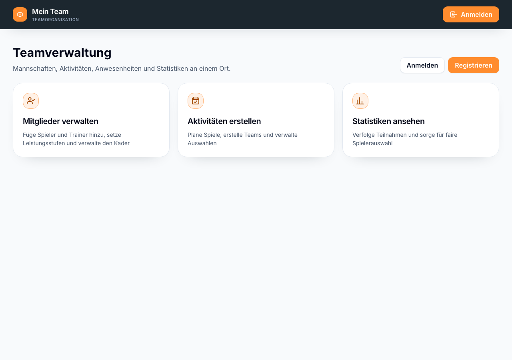
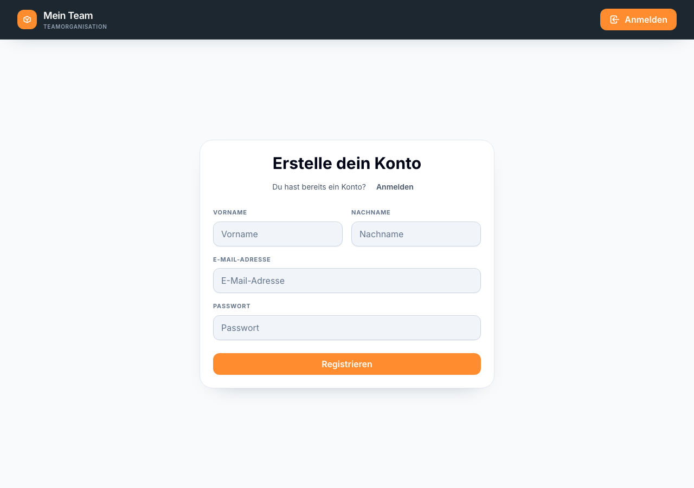
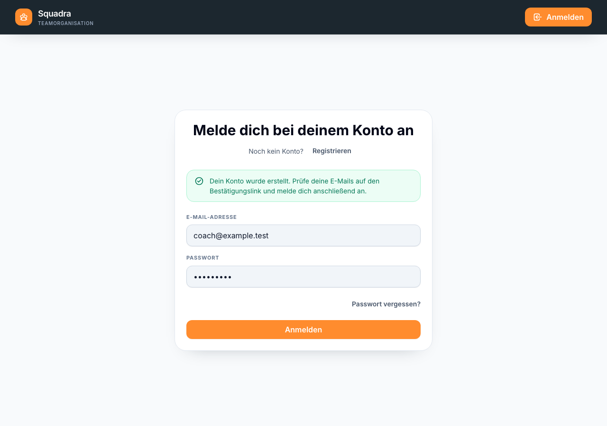
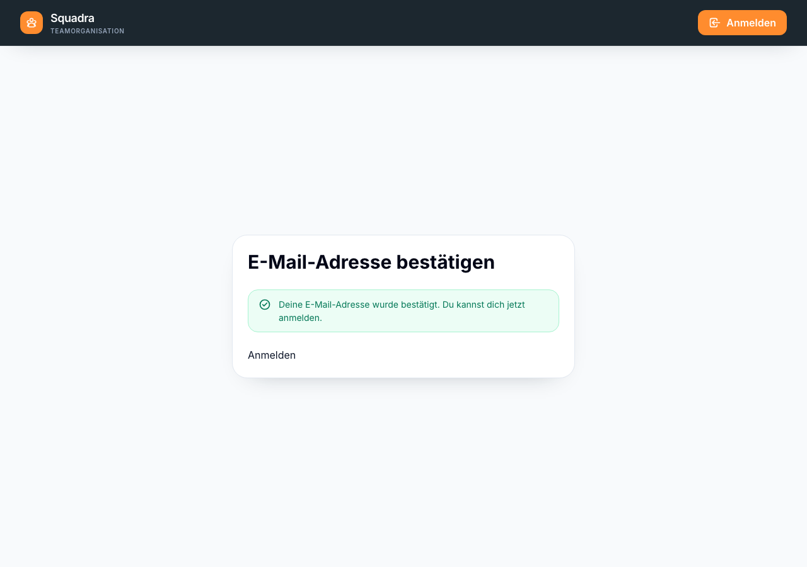

# Konto registrieren

Erstelle ein Konto bei Squadra, bevor du deine Mannschaft einrichtest.

**Ablauf:** Abgemeldete Startseite → Registrieren → Daten eingeben → Registrieren → E-Mail bestätigen → Anmelden → Mannschaft einrichten

1. Öffne Squadra. Wenn du abgemeldet bist, zeigt die Startseite die Schaltflächen **Anmelden** und **Registrieren**.

   

2. Wähle **Registrieren**, um das Kontoformular zu öffnen.

   

3. Gib **Vorname**, **Nachname**, **E-Mail-Adresse** und **Passwort** ein und wähle **Registrieren**. Squadra erstellt dein Konto und sendet eine Bestätigungs-E-Mail. Du wirst nach der Registrierung nicht angemeldet.

   

4. Öffne die Bestätigungs-E-Mail und wähle den darin enthaltenen Link. Er öffnet `/verify-email?token=…`; Squadra prüft damit den Token. Der Link ist 24 Stunden gültig.

   
5. Sobald die Seite die bestätigte E-Mail-Adresse anzeigt, wähle **Anmelden** und melde dich mit deiner registrierten E-Mail-Adresse und deinem Passwort an.
6. Fahre mit [Mannschaft einrichten]({{ '/de/set-up-a-squad.html' | relative_url }}) fort.

