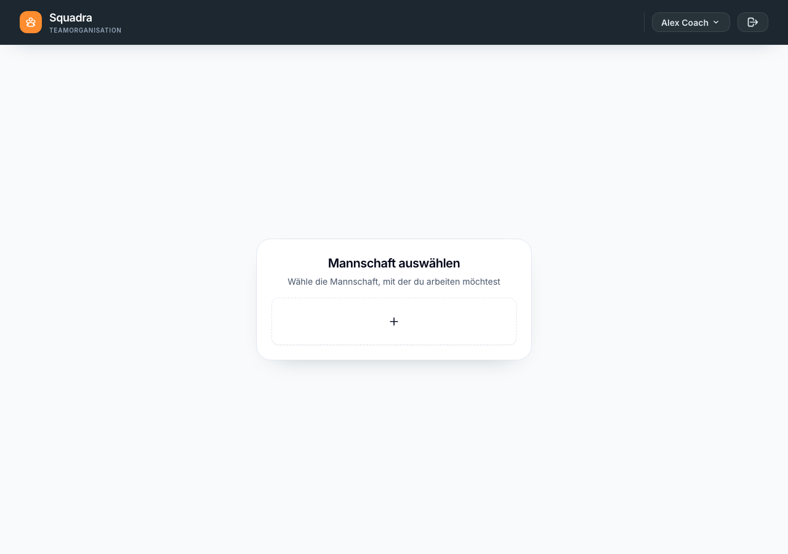
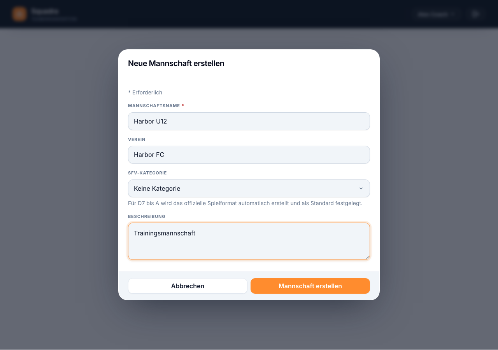
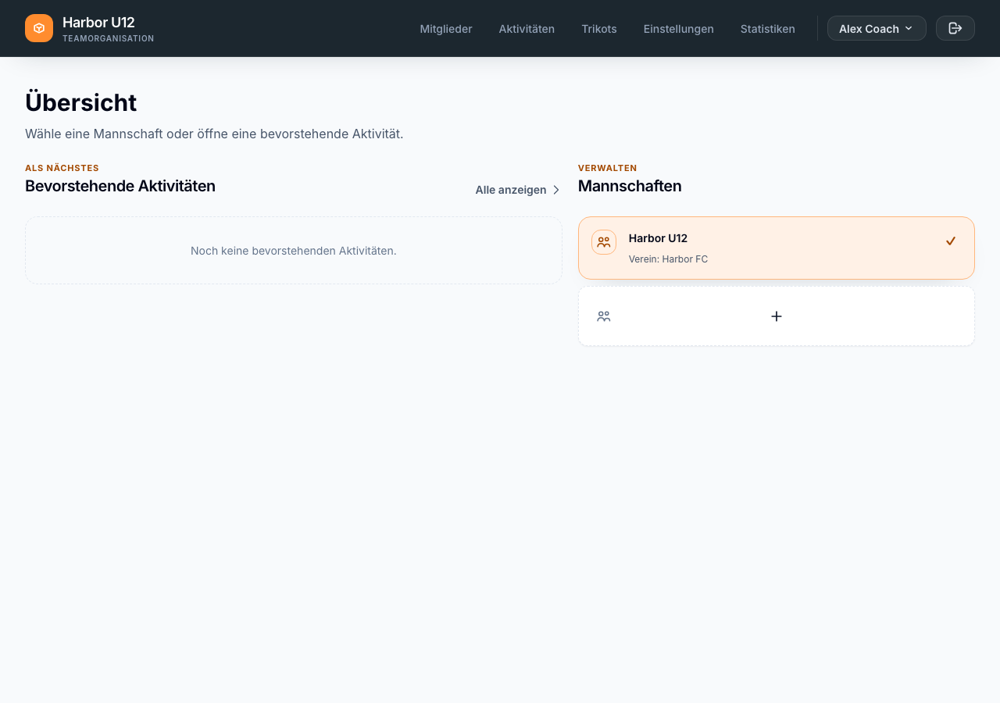

# Mannschaft einrichten

Erstelle eine Mannschaft und füge die ersten Spieler und Trainer hinzu. Wenn du deine Mitglieder in Spond verwaltest, verbinde Spond, bevor du Mitglieder manuell erfasst.

**Bevor du beginnst:** Melde dich bei Mein Team mit einem Konto an, mit dem du die Mannschaft erstellen oder verwalten kannst. [Registriere ein Konto]({{ '/de/konto-registrieren.html' | relative_url }}), wenn du noch keines hast.

## Mannschaft erstellen

1. Wähle auf **Übersicht** die Karte mit dem **+** unter **Mannschaften**. Wenn du stattdessen **Mannschaft auswählen** siehst, wähle dort die Karte mit dem **+**. Beide Aktionen tragen für Screenreader den Namen **Neue Mannschaft erstellen**.
2. Gib einen **Mannschaftsnamen** ein. **Verein** und **Beschreibung** sind optional.
3. Wähle bei Bedarf eine **SFV-Kategorie** oder belasse die Auswahl bei **Keine Kategorie**. Für die Kategorien D7 bis A erstellt Mein Team automatisch das offizielle Spielformat und legt es als Standard fest. Das Formular zeigt, was die gewählte Kategorie mitbringt.
4. Wähle **Mannschaft erstellen**. Prüfe, ob die neue Mannschaft auf **Übersicht** ausgewählt ist.

*Wenn du zuerst eine Mannschaft auswählen sollst, beginne hier.*

*Gib die Mannschaftsdaten ein und wähle Mannschaft erstellen.*

*Die neue Mannschaft ist auf Übersicht ausgewählt.*

## Quelle für Mitgliederdaten wählen

Wenn du deine Mitglieder in Spond verwaltest, folge zuerst der Anleitung [Spond-Gruppe verbinden]({{ '/de/spond-gruppe-verbinden.html' | relative_url }}). Nach der Verknüpfung liefert Spond die Stammdaten der Mitglieder; das manuelle Erstellen und Löschen von Mitgliedern ist ausgeblendet. Die Synchronisierung erfolgt separat und mit einer Vorschau. Die Spond-Anleitung erklärt auch, welche weiteren Daten aus Spond stammen und welche Planungsdaten in Mein Team bleiben.

Wenn du die Mitglieder in Mein Team verwaltest, helfen dir diese Anleitungen beim Hinzufügen:

- [Spieler hinzufügen]({{ '/de/spieler-hinzufuegen.html' | relative_url }})
- [Trainer hinzufügen]({{ '/de/trainer-hinzufuegen.html' | relative_url }})

Deine Mannschaft ist bereit für die erste Aktivität. Öffne **Aktivitäten**, um ein Spiel oder Turnier zu planen.
