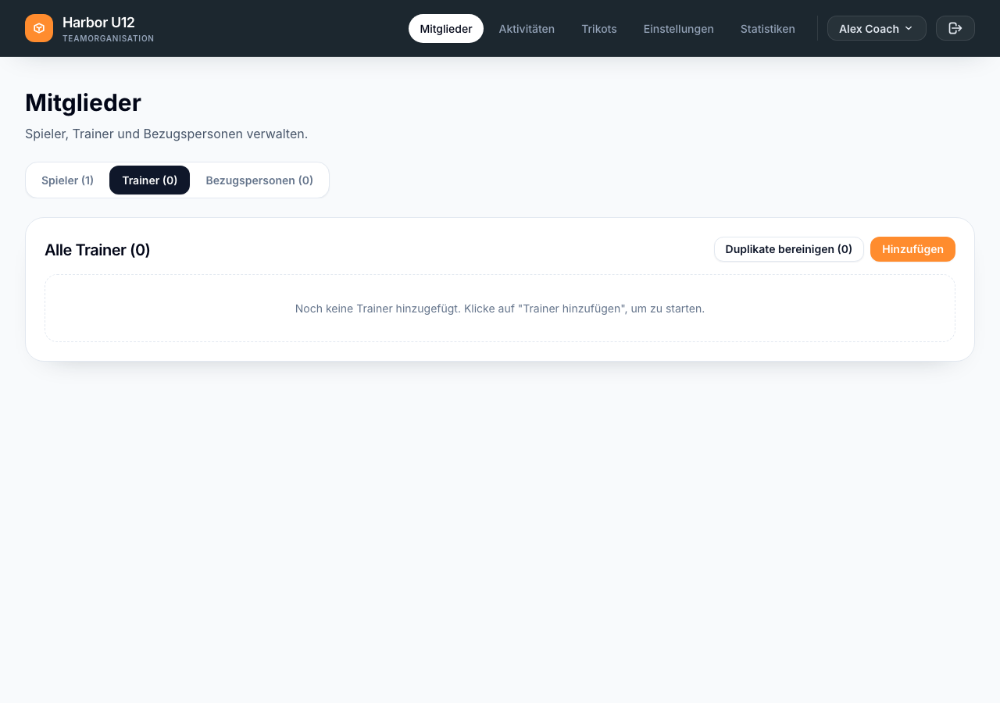
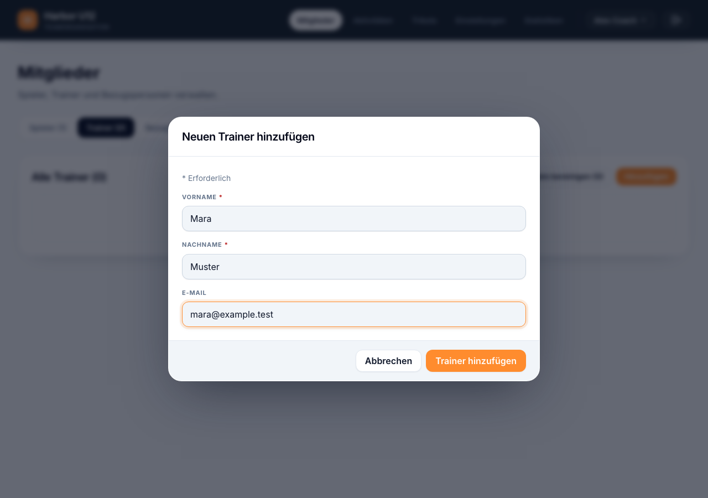
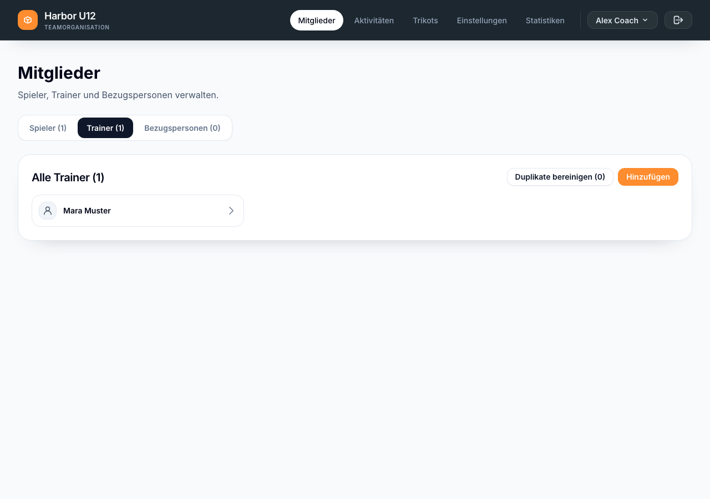

# Mannschaft einrichten

Erstelle eine Mannschaft und füge die ersten Spieler und Trainer hinzu. Wenn du deine Mitglieder in Spond verwaltest, verbinde Spond, bevor du Mitglieder manuell erfasst.

**Bevor du beginnst:** Melde dich bei Mein Team an. Du brauchst ein Konto, mit dem du die Mannschaft erstellen oder verwalten kannst.

## Mannschaft erstellen

1. Wähle auf **Übersicht** die Karte mit dem **+** unter **Mannschaften**. Wenn du stattdessen **Mannschaft auswählen** siehst, wähle dort die Karte mit dem **+**. Beide Aktionen tragen für Screenreader den Namen **Neue Mannschaft erstellen**.
2. Gib einen **Mannschaftsnamen** ein. **Verein** und **Beschreibung** sind optional.
3. Wähle bei Bedarf eine **SFV-Kategorie** oder belasse die Auswahl bei **Keine Kategorie**. Für die Kategorien D7 bis A erstellt Mein Team automatisch das offizielle Spielformat und legt es als Standard fest. Das Formular zeigt, was die gewählte Kategorie mitbringt.
4. Wähle **Mannschaft erstellen**. Prüfe, ob die neue Mannschaft auf **Übersicht** ausgewählt ist.

*Wenn du zuerst eine Mannschaft auswählen sollst, beginne hier.*

*Gib die Mannschaftsdaten ein und wähle Mannschaft erstellen.*

*Die neue Mannschaft ist auf Übersicht ausgewählt.*

## Quelle für Mitgliederdaten wählen

Wenn du deine Mitglieder in Spond verwaltest, folge zuerst der separaten Anleitung **Spond-Gruppe verbinden**. Nach der Verknüpfung liefert Spond die Stammdaten der Mitglieder; das manuelle Erstellen und Löschen von Mitgliedern ist ausgeblendet. Die Synchronisierung erfolgt separat und mit einer Vorschau. Die Spond-Anleitung erklärt auch, welche weiteren Daten aus Spond stammen und welche Planungsdaten in Mein Team bleiben.

Wenn du die Mitglieder in Mein Team verwaltest, fahre unten fort.

## Spieler hinzufügen

1. Öffne **Mitglieder → Spieler** und wähle **Hinzufügen**.
2. Gib **Vorname**, **Nachname** und **Geburtsdatum** ein. Lege **Level** und **Status** fest. Die **bevorzugte Trikotnummer** ist optional.
3. Wähle **Spieler hinzufügen** und prüfe, ob der Spieler in der Liste erscheint.

*Öffne Mitglieder → Spieler und wähle Hinzufügen.*

*Trage die Spielerdaten ein.*

*Prüfe, ob der Spieler in der Liste erscheint.*

## Trainer hinzufügen

1. Öffne **Mitglieder → Trainer** und wähle **Hinzufügen**.
2. Gib **Vorname** und **Nachname** des Trainers ein. Die **E-Mail-Adresse** ist optional.
3. Wähle **Trainer hinzufügen** und prüfe, ob der Trainer in der Liste erscheint.

*Öffne Mitglieder → Trainer und wähle Hinzufügen.*

*Trage die Trainerdaten ein.*

*Prüfe, ob der Trainer in der Liste erscheint.*

Deine Mannschaft ist bereit für die erste Aktivität. Öffne **Aktivitäten**, um ein Spiel oder Turnier zu planen.
