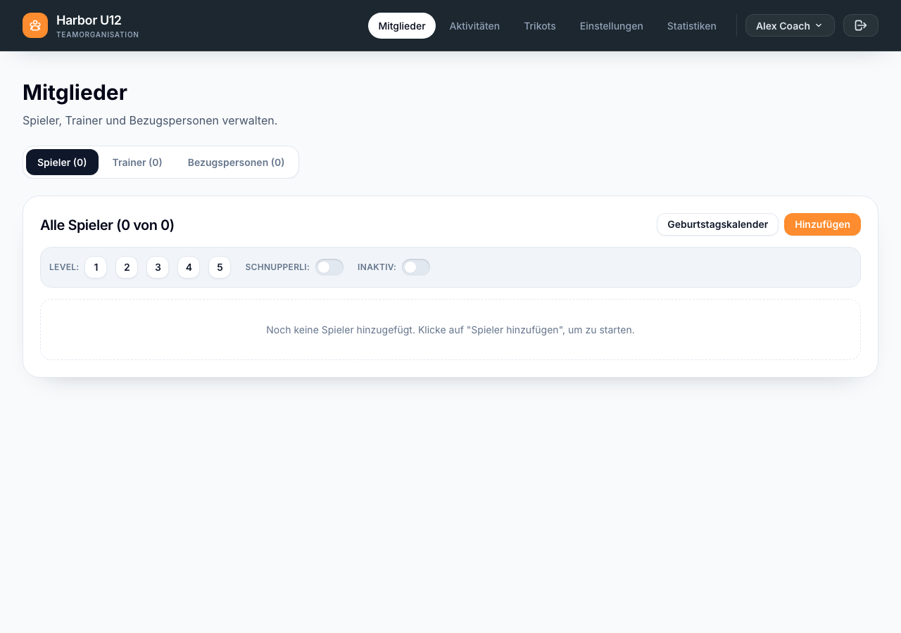
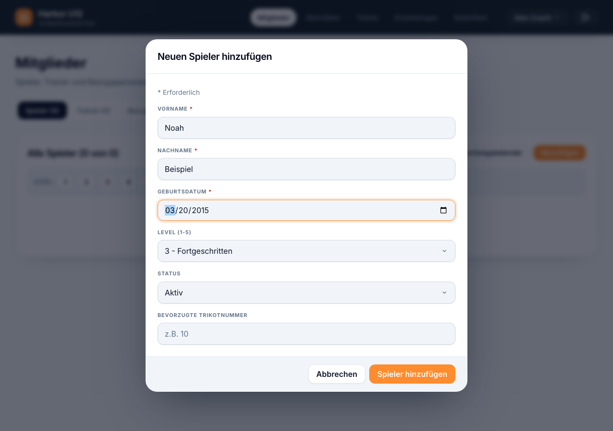
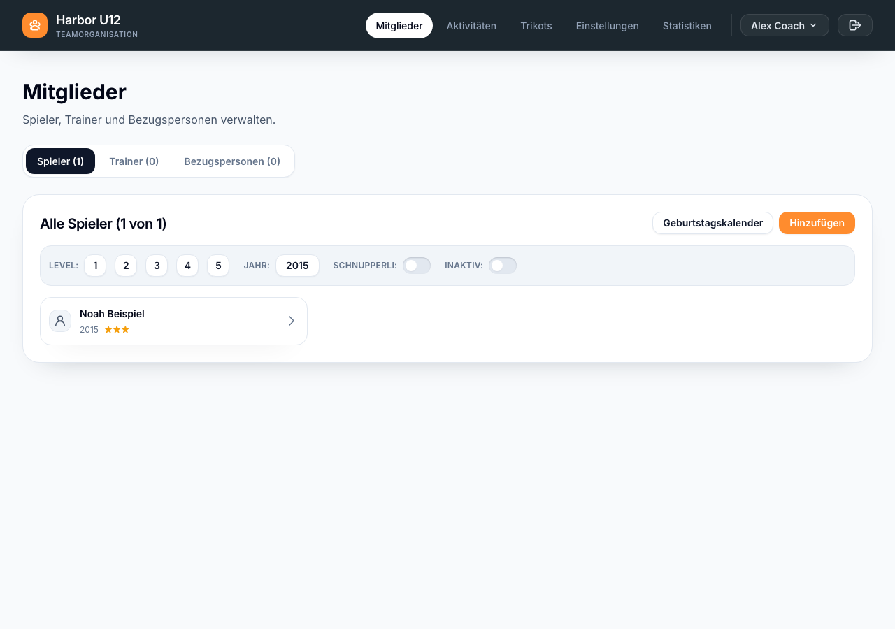

# Spieler hinzufügen

Du brauchst zuerst eine Mannschaft in Mein Team. Wenn du Mitglieder in Spond verwaltest, verbinde Spond und synchronisiere die Mitglieder, anstatt sie manuell hinzuzufügen.

1. Öffne **Mitglieder → Spieler** und wähle **Hinzufügen**.
2. Gib **Vorname**, **Nachname** und **Geburtsdatum** ein. Lege **Level** und **Status** fest. Die **bevorzugte Trikotnummer** ist optional.
3. Wähle **Spieler hinzufügen** und prüfe, ob der Spieler in der Liste erscheint.

*Öffne Mitglieder → Spieler und wähle Hinzufügen.*

*Trage die Spielerdaten ein.*

*Prüfe, ob der Spieler in der Liste erscheint.*

[Zurück zu Mannschaft einrichten]({{ '/de/set-up-a-squad.html' | relative_url }})
