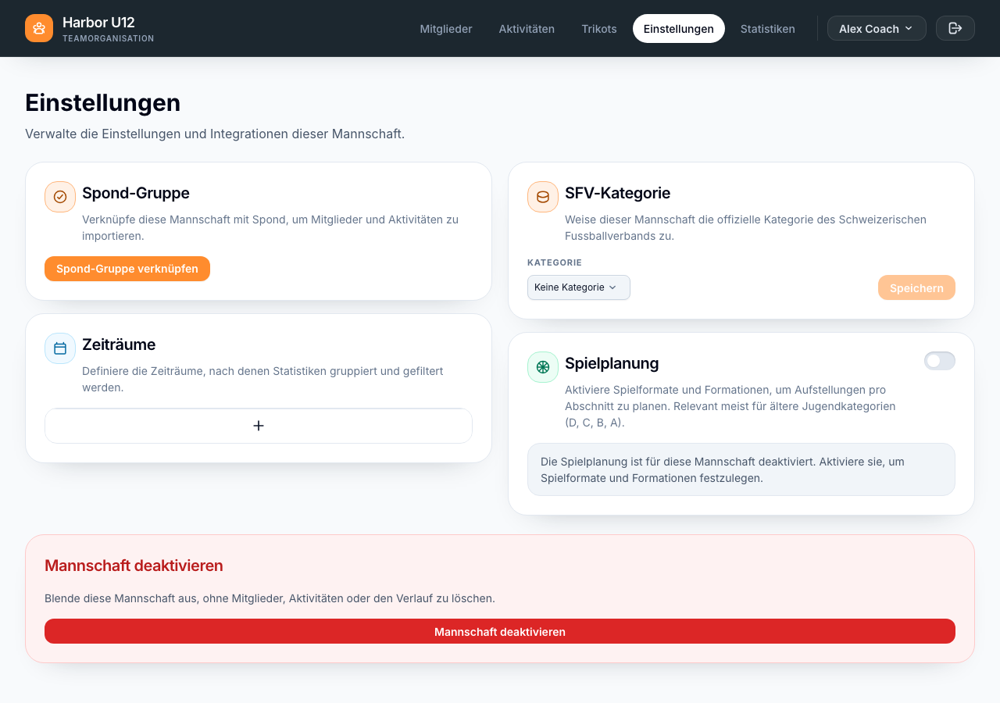
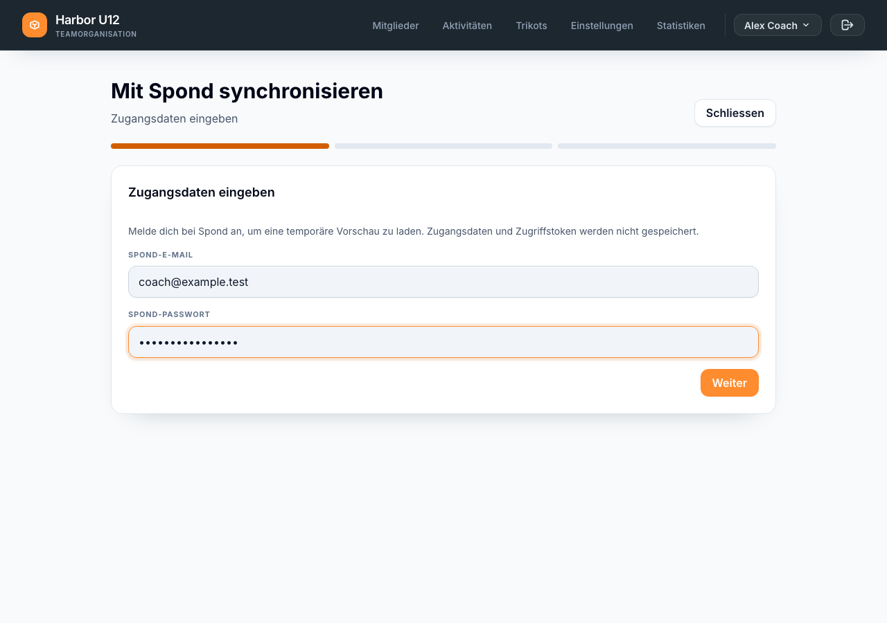
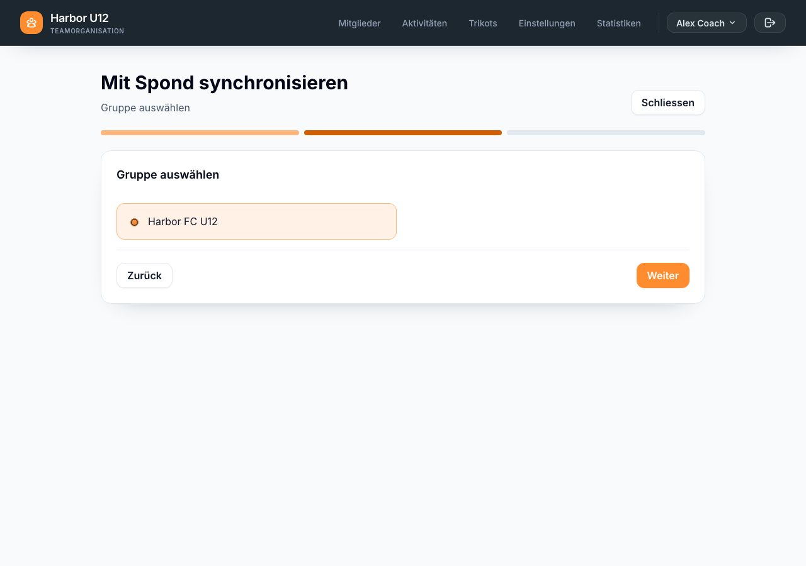

# Spond-Gruppe verbinden

Verbinde eine Spond-Gruppe mit einer Mannschaft, damit du ihre Mitglieder und Aktivitäten in Squadra prüfen und synchronisieren kannst.

**Bevor du beginnst:** Erstelle die Mannschaft oder wähle sie aus, die du verbinden möchtest. Du benötigst außerdem die Spond-E-Mail-Adresse und das Passwort eines Kontos mit Zugriff auf die Gruppe. [Richte eine Mannschaft ein]({{ '/de/set-up-a-squad.html' | relative_url }}), falls du noch keine erstellt hast.

## Gruppe verbinden

1. Öffne **Einstellungen** der Mannschaft, die du verbinden möchtest.

   

2. Wähle im Abschnitt **Spond-Gruppe** die Option **Spond-Gruppe verknüpfen**.
3. Gib deine Spond-E-Mail-Adresse und dein Passwort ein und wähle **Weiter**. Squadra meldet sich bei Spond an und lädt die Gruppen, auf die dieses Konto Zugriff hat. Deine Spond-Zugangsdaten und das Zugriffstoken werden für die Anfrage verwendet und nicht gespeichert.

   

4. Wähle die Gruppe aus, die du mit dieser Mannschaft verbinden möchtest, und wähle **Weiter**.

   

5. Wenn Squadra **Gruppe verknüpft** bestätigt, wähle **Fertig**. Die Spond-Gruppe ist jetzt mit der Mannschaft verbunden.

Beim Verbinden werden keine Mitglieder oder Aktivitäten importiert oder geändert. Die Gruppe wird lediglich mit der Mannschaft verknüpft.

## Daten später synchronisieren

Nach der Verknüpfung kannst du über **Sync** auf **Mitglieder**, **Mitglieder → Trainer** oder **Aktivitäten** die verknüpfte Gruppe synchronisieren. Ein Vorgang prüft Spieler, Bezugspersonen, Trainer und Aktivitäten gemeinsam. Melde dich bei Aufforderung bei Spond an, wähle den Aktivitätszeitraum, prüfe die vorgeschlagenen Änderungen und starte die Synchronisierung.

Wenn du die verbundene Gruppe ändern möchtest, öffne die **Einstellungen** der Mannschaft und trenne zuerst die aktuelle Spond-Gruppe. Danach kannst du eine andere Gruppe verbinden. Beim Trennen wird die zukünftige Synchronisierung beendet; bereits importierte Mitglieder und Aktivitäten bleiben in Squadra erhalten.
