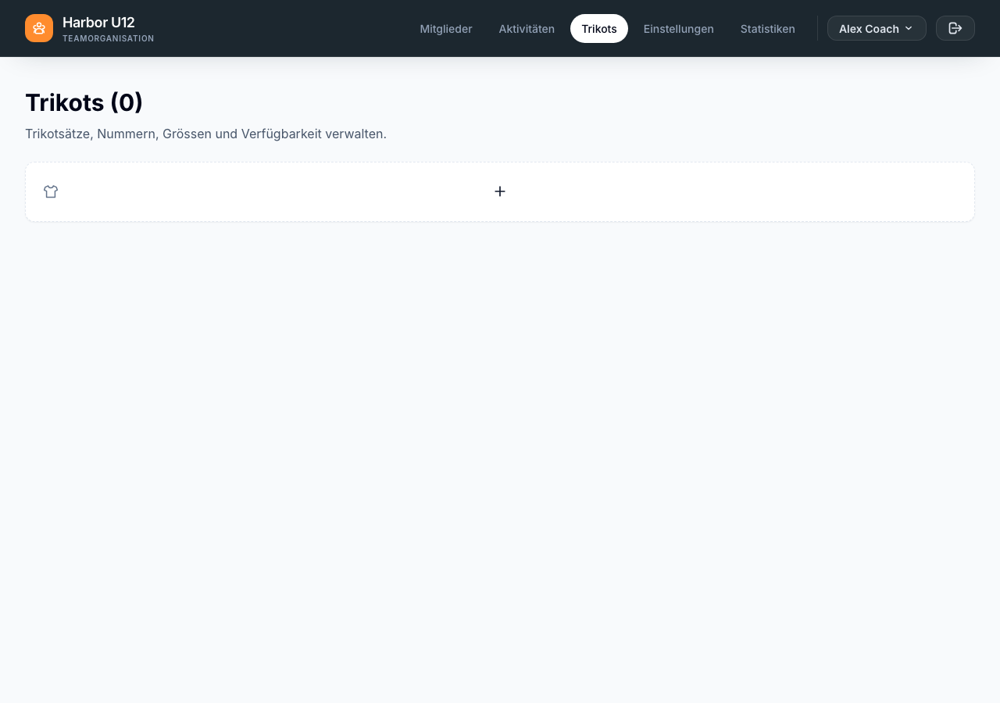
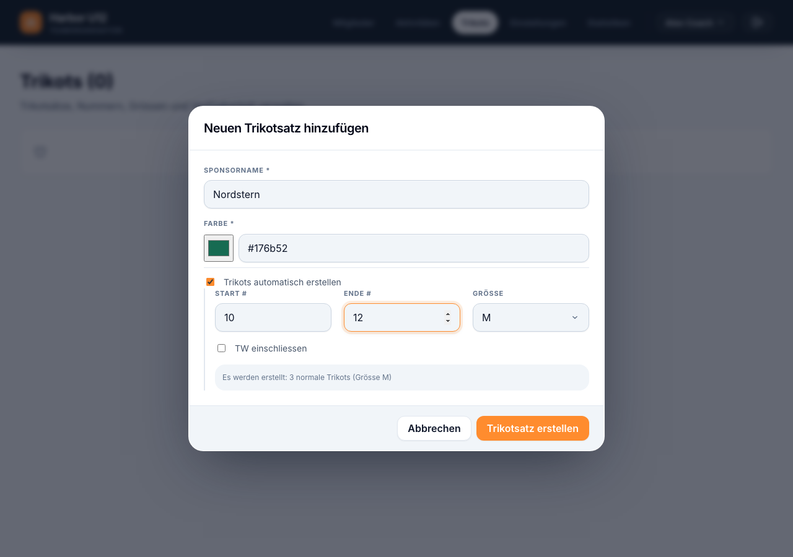

# Trikotsätze verwalten

Unter **Trikots** verwaltest du den wiederverwendbaren Trikotbestand einer Mannschaft. Du kannst Sätze für verschiedene Sponsoren oder Farben erstellen, Trikots hinzufügen und vorübergehend nicht verfügbare Trikots markieren.

**Vor dem Start:** Melde dich an und wähle die Mannschaft aus, deren Trikots du verwalten möchtest.

## Trikotsatz erstellen

1. Öffne **Trikots** und wähle die Plus-Schaltfläche **Neuen Trikotsatz hinzufügen**.
2. Gib den Sponsorennamen ein und wähle eine Farbe.
3. Wenn du mehrere Trikots auf einmal erstellen möchtest, aktiviere **Trikots automatisch erstellen** und wähle einen Nummernbereich sowie eine Grösse. Der Bereich kann Nummern von 1 bis 99 enthalten.
4. Wähle **Trikotsatz erstellen**. Der neue Satz erscheint in der Liste, sortiert nach Sponsor und danach nach Farbe.

*Wähle die Plus-Schaltfläche, um den ersten Satz zu erstellen.*

*Lege einen Nummernbereich und eine Grösse fest, um Trikots im Satz zu erstellen.*

## Trikots hinzufügen und bearbeiten

1. Klappe einen Trikotsatz auf, um seine Trikots zu sehen, und wähle **Neues Trikot hinzufügen**.
2. Gib eine eindeutige Trikotnummer von 1 bis 99 ein und wähle eine Grösse. Optional kannst du das Trikot als Torwarttrikot oder als nicht verfügbar markieren.
3. Wähle **Trikot hinzufügen**. Innerhalb eines Satzes muss jede Trikotnummer eindeutig sein.
4. Um ein Trikot zu ändern, wähle die Bearbeiten-Aktion, passe die Angaben an und speichere. Zum Entfernen wählst du die Entfernen-Aktion und bestätigst.

Ein nicht verfügbares Trikot kann bei der Trikotzuweisung für eine zukünftige Aktivität nicht ausgewählt werden.

## Trikotsatz bearbeiten oder löschen

- Mit der Bearbeiten-Aktion eines Satzes änderst du Sponsor oder Farbe.
- Mit der Löschen-Aktion und anschliessender Bestätigung entfernst du den Satz samt Trikotbestand.

Das Löschen eines Trikotsatzes kann nicht rückgängig gemacht werden. Die Zuweisung von Trikots zu einem Team erfolgt separat bei der Planung einer Aktivität.
