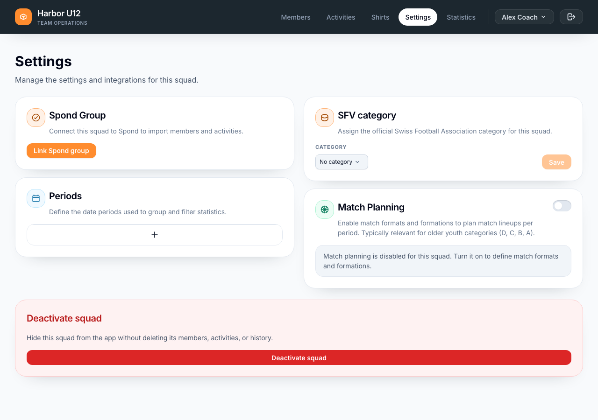
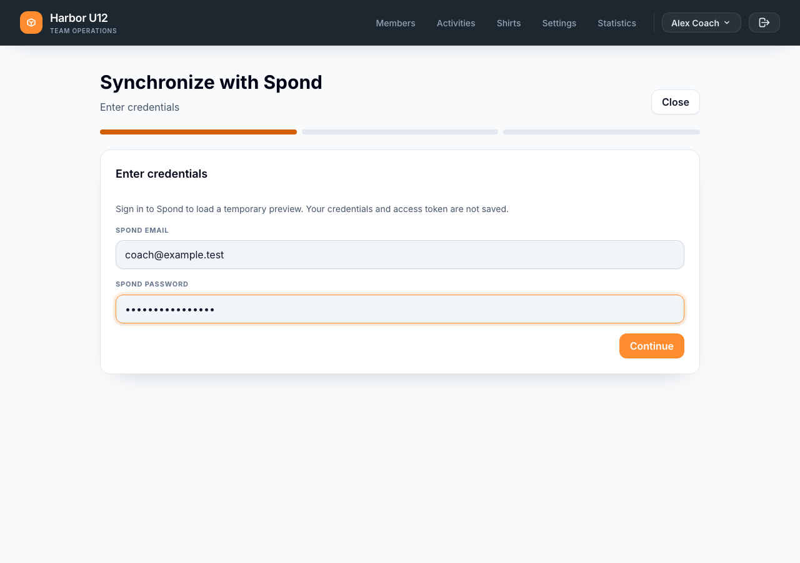
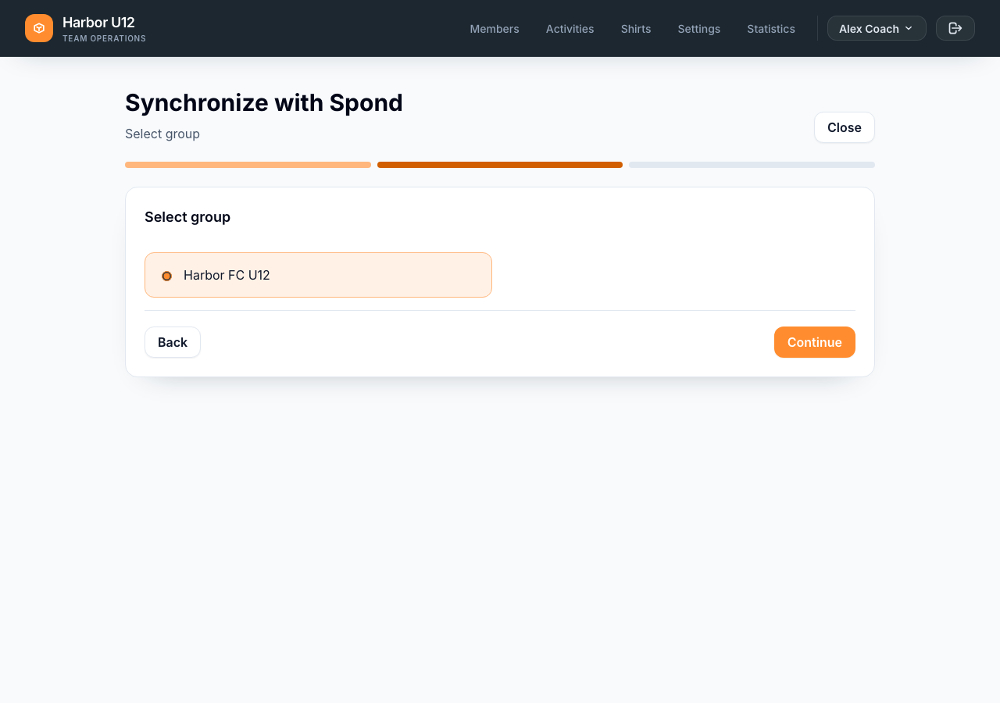

# Connect a Spond group

Link a Spond group to a squad so you can review and synchronize its members and activities from My Team.

**Before you start:** Create or select the squad you want to connect. You also need the Spond email address and password for an account that can access the group. [Set up a squad]({{ '/en/set-up-a-squad.html' | relative_url }}) if you have not created one yet.

## Link the group

1. Open **Settings** for the squad you want to connect.

   

2. In the **Spond Group** section, select **Link Spond group**.
3. Enter your Spond email address and password, then select **Continue**. My Team signs in to Spond and loads the groups available to that account. Your Spond credentials and access token are used for the request and are not saved.

   

4. Select the group you want to connect to this squad, then select **Continue**.

   

5. When My Team confirms **Group linked**, select **Done**. The Spond group is now connected to the squad.

Connecting the group does not import or change any members or activities. It only links the group to the squad.

## Synchronize data later

After linking, use **Sync** from **Members**, **Members → Trainers**, or **Activities** to synchronize the linked group. One run reviews players, guardians, trainers, and activities together. Sign in to Spond when prompted, choose the activity date range, review the proposed changes, and apply the sync.

If you need to change the connected group, open squad **Settings** and unlink the current Spond group before linking another one. Unlinking stops future synchronization; existing imported members and activities remain in My Team.
