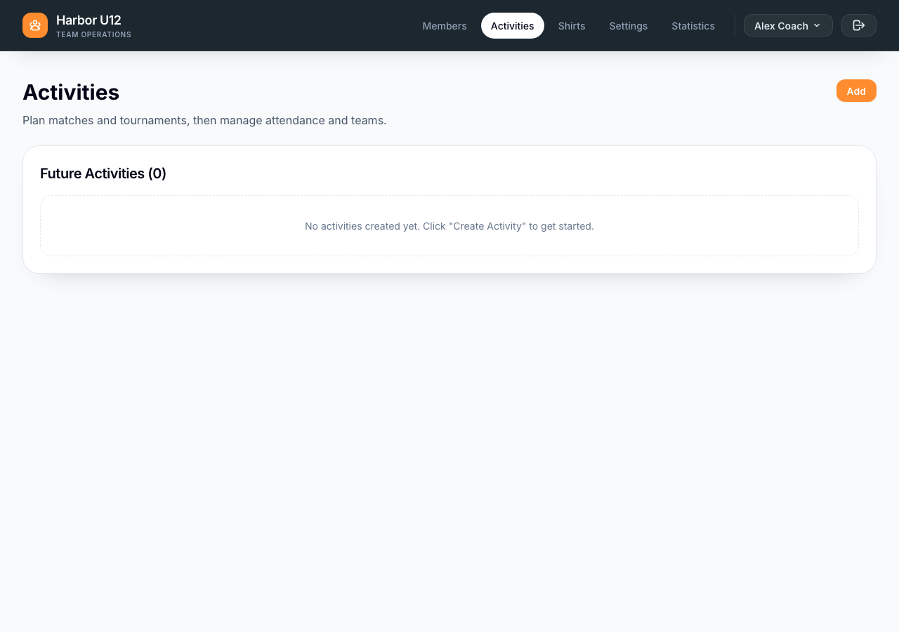
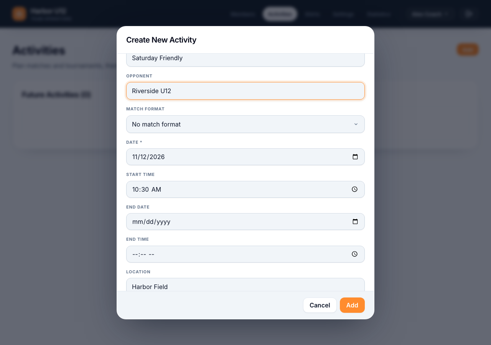
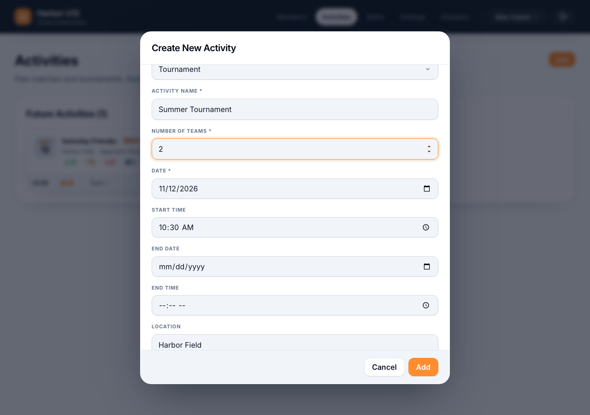
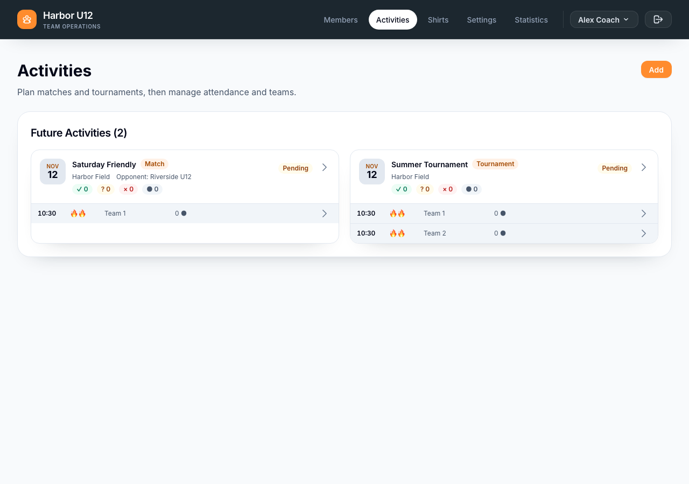

# Create an activity

Create a match or tournament from **Activities**. You need to be signed in, have a squad selected, and have the admin or trainer role. This manual creation flow is available for squads that are not linked to Spond. For a linked squad, create activities in Spond and synchronize them.

1. Open **Activities** and select **Add**.
2. Keep **Match** selected or choose **Tournament** under **Activity type**.
3. Enter an activity name, date, and start time. You can also enter an end date and time, a location, and the other details shown for the selected activity type. For a match, you can add the opponent and choose a match format. For a tournament, enter the number of teams.
4. Set the minimum and maximum players per team. The form uses the selected match format's defaults when available; otherwise, it starts with a minimum of 6 and a maximum of 9 players per team.
5. Select **Add**. The activity appears under **Future Activities** or **Past Activities**, depending on its date.

*Open Activities and select Add to start.*

*Enter the match schedule, location, and optional opponent.*

*Choose Tournament and set the number of teams.*

The app creates one default team for a match and the requested number of teams for a tournament. New teams start with no selected players. Invitations and player assignments are handled after the activity is created.

*Check that both activities appear in the future list.*

[Back to Set up a squad]({{ '/en/set-up-a-squad.html' | relative_url }})
