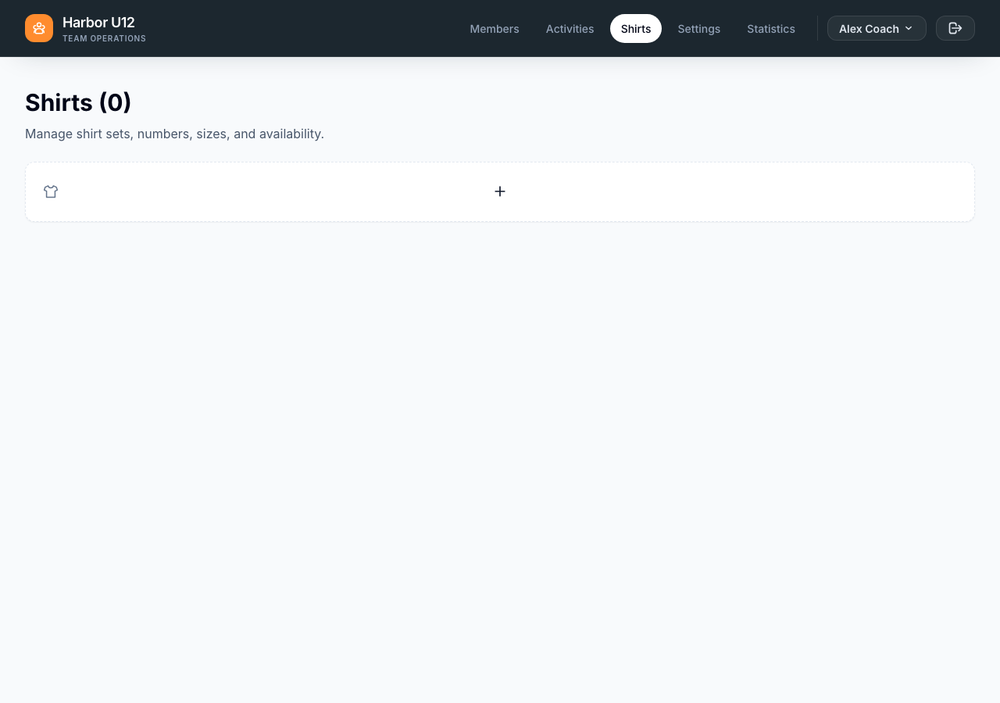
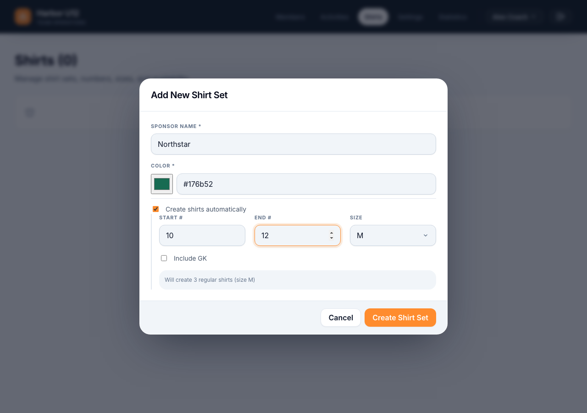

# Manage shirt sets

Use **Shirts** to keep a squad’s reusable shirt inventory up to date. You can create sets for different sponsors or colors, add shirts, and mark shirts that are temporarily unavailable.

**Before you start:** Sign in and select the squad whose shirts you want to manage.

## Create a shirt set

1. Open **Shirts** and select the **Add New Shirt Set** plus button.
2. Enter the sponsor name and choose a color.
3. To create several shirts at once, select **Create shirts automatically**, then choose a number range and size. The range can include numbers from 1 to 99.
4. Select **Create Shirt Set**. The new set appears in the list, ordered by sponsor and then color.

*Select the plus button to create the first set.*

*Choose a number range and size to create shirts with the set.*

## Add and update shirts

1. Expand a shirt set to see its shirts, then select **Add New Shirt**.
2. Enter a unique shirt number from 1 to 99 and choose a size. Optionally mark it as a goalkeeper shirt or unavailable.
3. Select **Add Shirt**. Shirt numbers must be unique within their set.
4. To change a shirt, select its edit action, update the details, and save. To remove it, select its remove action and confirm.

An unavailable shirt cannot be selected when assigning shirts to players for a future activity.

## Edit or delete a shirt set

- Use the edit action on a set to change its sponsor name or color.
- Use the delete action and confirm to remove the set and its shirt inventory.

Deleting a shirt set cannot be undone. Shirt assignment to a team is handled separately when planning an activity.
