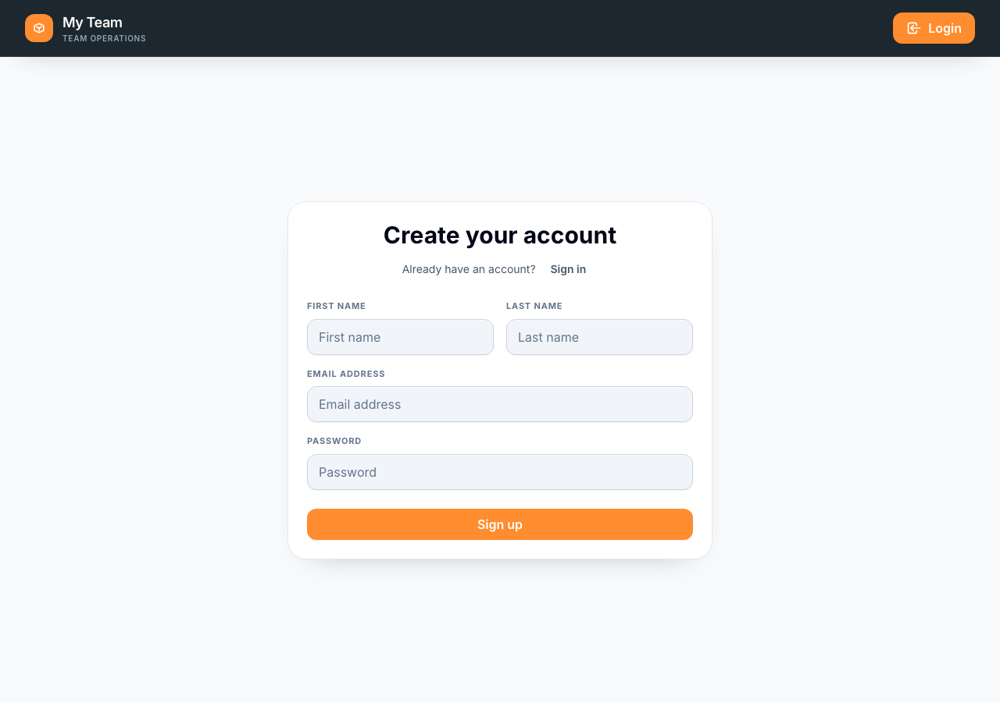

# Register an account

Create a My Team account before setting up your squad.

**Flow:** Home page → Register → Enter your details → Sign up → Verify your email → Sign in → Set up a squad

1. Open the My Team home page and select **Register**.
2. Enter your **First name**, **Last name**, **Email address**, and **Password**.
3. Select **Sign up**. My Team creates your account and sends a verification email. You are not signed in yet because registration does not issue an authentication token.
4. Open the verification email and follow its link. It opens the frontend at `/verify-email?token=…`; the token is included in the URL so the app can verify your address. The link expires after 24 hours.
5. After the email address is verified, sign in with your email address and password.
6. Continue to [set up a squad]({{ '/en/set-up-a-squad.html' | relative_url }}).

*Enter your details and select Sign up. Then verify your email before signing in.*

