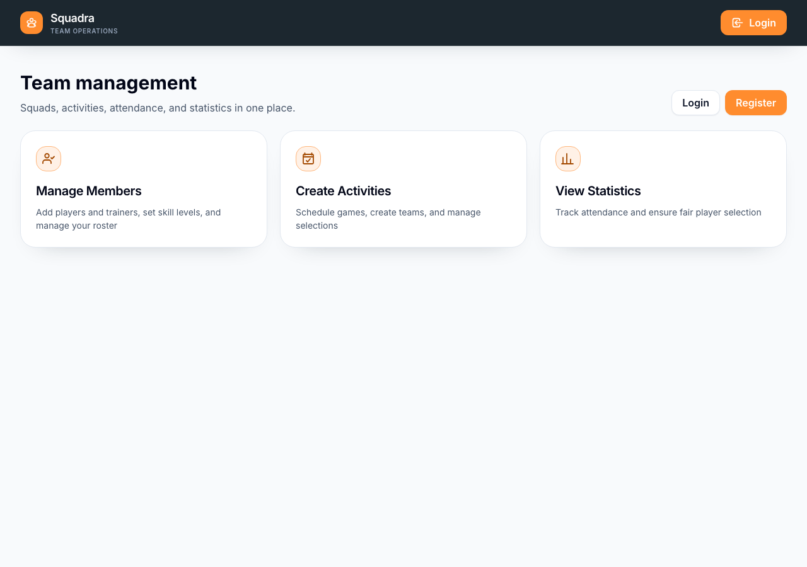
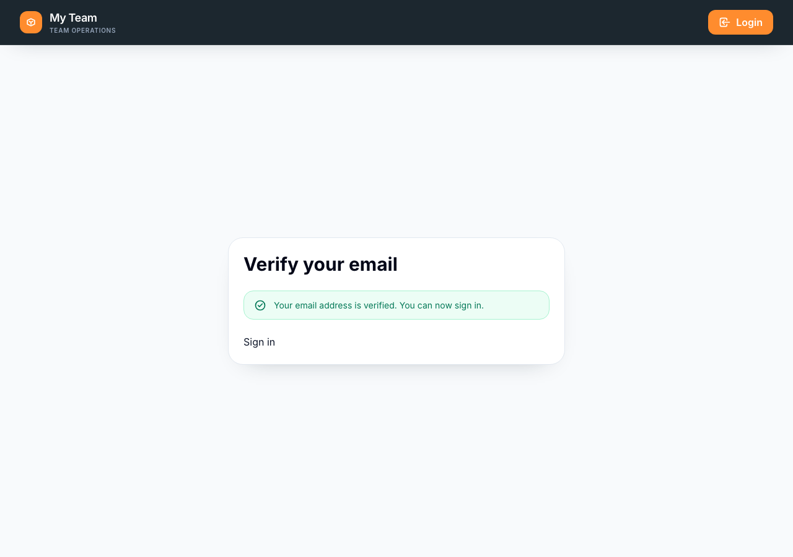

# Register an account

Create a Squadra account before setting up your squad.

**Flow:** Logged-out home page → Register → Enter your details → Sign up → Verify your email → Sign in → Set up a squad

1. Open Squadra. When you are signed out, the home page offers **Login** and **Register**.

   

2. Select **Register** to open the account form.

   

3. Enter your **First name**, **Last name**, **Email address**, and **Password**, then select **Sign up**. Squadra creates your account and sends a verification email. Registration does not sign you in.

   

4. Open the verification email and select its link. It opens `/verify-email?token=…`, where Squadra checks the token. The link expires after 24 hours.

   
5. When the page confirms your email address, select **Sign in** and log in with the email address and password you registered with.
6. Continue to [set up a squad]({{ '/en/set-up-a-squad.html' | relative_url }}).

