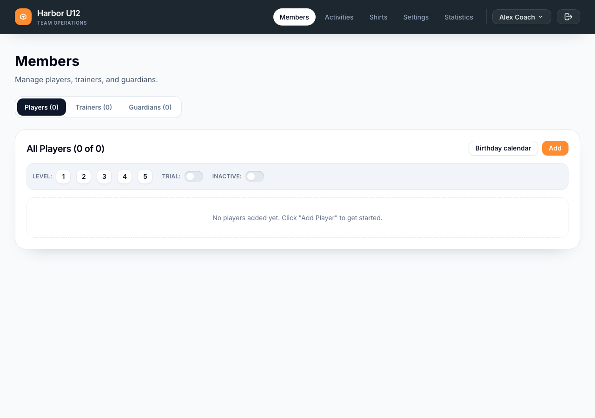
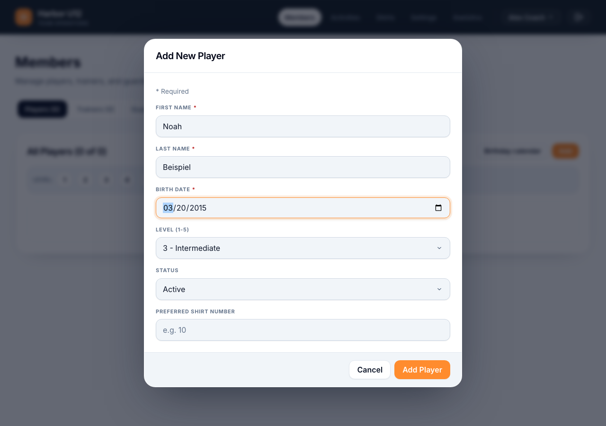
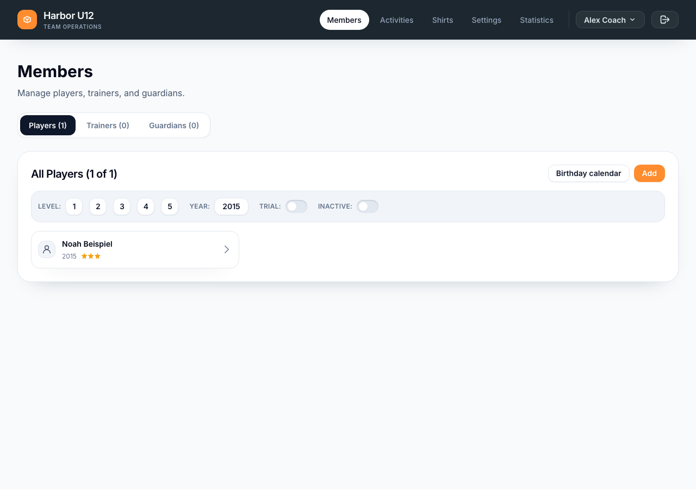
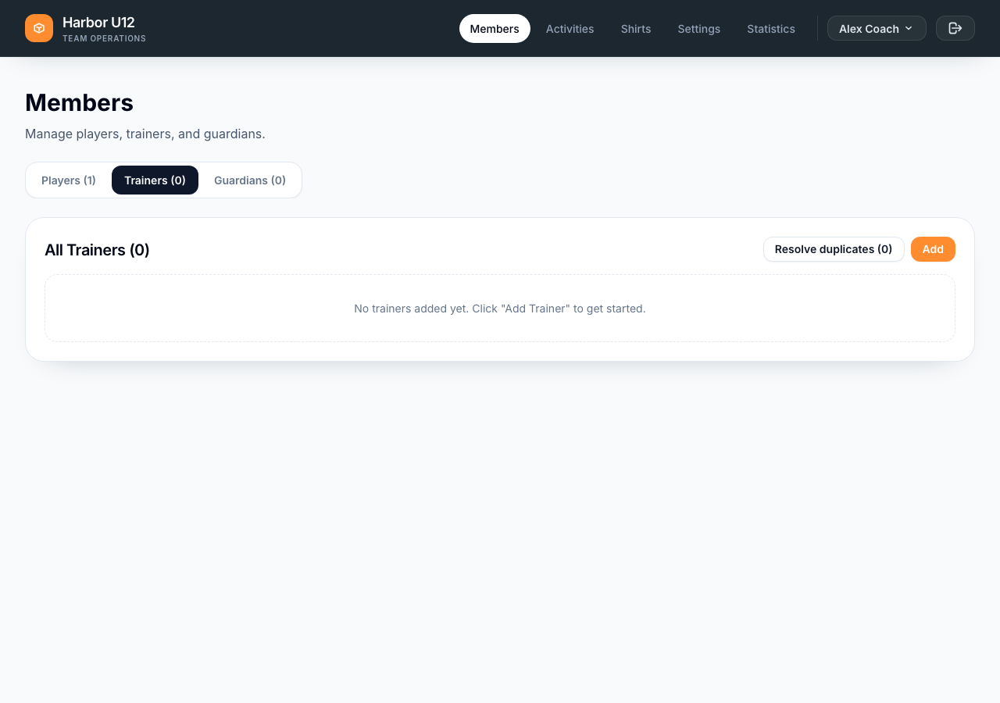
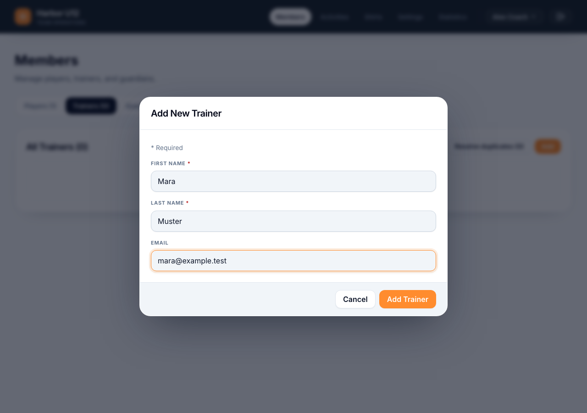
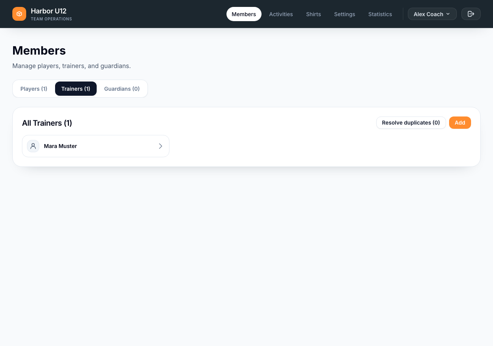

# Set up a squad

Create a squad, then add its first players and trainers. If Spond holds your roster, connect it before adding members manually.

**Before you start:** Sign in to My Team. You need an account that can create or manage the squad.

## Create the squad

1. On **Overview**, select the **+** card under **Squads**. If you see **Select Your Squad** instead, select the **+** card there. Both actions are named **Create a new squad** for screen readers.
2. Enter a **Squad name**. **Club** and **Description** are optional.
3. Choose an **SFV category** if one applies, or leave **No category** selected. For categories D7 through A, My Team creates the official match format and sets it as the default. The form shows what the selected category provides.
4. Select **Create Squad**. Check that the new squad is selected on **Overview**.

*If prompted to select a squad, start here.*

*Enter the squad details and select Create Squad.*

*The new squad is selected on Overview.*

## Choose where member data comes from

If you keep your roster in Spond, follow the separate **Connect a Spond group** guide before entering members. Once linked, Spond supplies member identity data; manual member creation and deletion are hidden. Synchronization is a separate, reviewed action. The Spond guide explains which other data comes from Spond and which planning details stay in My Team.

If you manage members in My Team, continue below.

## Add a player

1. Open **Members → Players** and select **Add**.
2. Enter the player's **First name**, **Last name**, and **Birth Date**. Set **Level** and **Status**. **Preferred Shirt Number** is optional.
3. Select **Add Player** and check that the player appears in the Players list.

*Open Members → Players and select Add.*

*Enter the player's details.*

*Check that the player appears in the list.*

## Add a trainer

1. Open **Members → Trainers** and select **Add**.
2. Enter the trainer's **First name** and **Last name**. **Email** is optional.
3. Select **Add Trainer** and check that the trainer appears in the Trainers list.

*Open Members → Trainers and select Add.*

*Enter the trainer's details.*

*Check that the trainer appears in the list.*

Your squad is ready for its first activity. Open **Activities** to plan a match or tournament.
