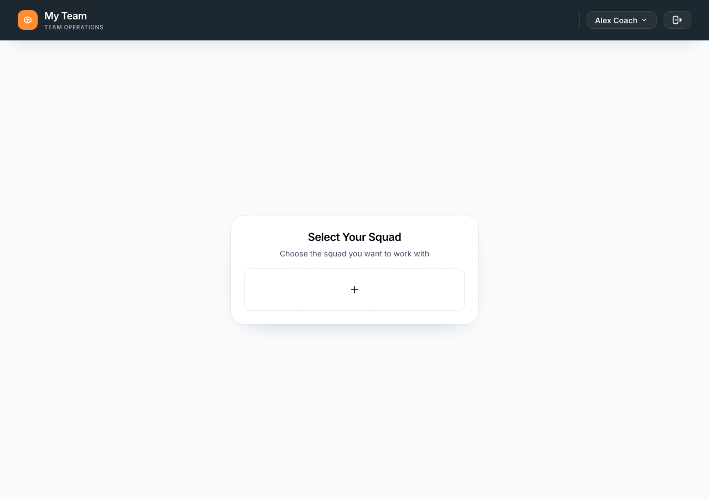
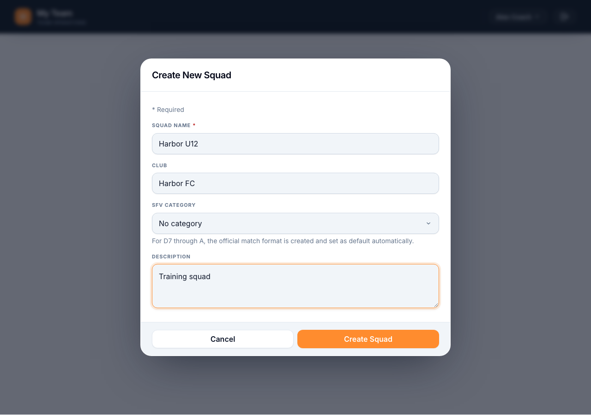
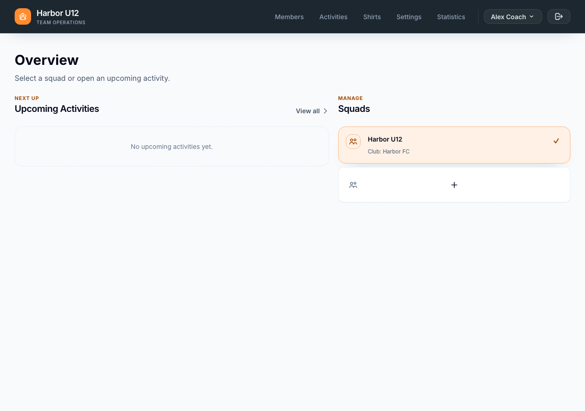

# Set up a squad

Create a squad, then add its first players and trainers. If Spond holds your roster, connect it before adding members manually.

**Before you start:** Sign in to My Team with an account that can create or manage the squad. [Register an account]({{ '/en/register-an-account.html' | relative_url }}) if you don't have one yet.

## Create the squad

1. On **Overview**, select the **+** card under **Squads**. If you see **Select Your Squad** instead, select the **+** card there. Both actions are named **Create a new squad** for screen readers.
2. Enter a **Squad name**. **Club** and **Description** are optional.
3. Choose an **SFV category** if one applies, or leave **No category** selected. For categories D7 through A, My Team creates the official match format and sets it as the default. The form shows what the selected category provides.
4. Select **Create Squad**. Check that the new squad is selected on **Overview**.

*If prompted to select a squad, start here.*

*Enter the squad details and select Create Squad.*

*The new squad is selected on Overview.*

## Choose where member data comes from

If you keep your roster in Spond, follow the [Connect a Spond group]({{ '/en/connect-a-spond-group.html' | relative_url }}) guide before entering members. Once linked, Spond supplies member identity data; manual member creation and deletion are hidden. Synchronization is a separate, reviewed action. The Spond guide explains which other data comes from Spond and which planning details stay in My Team.

If you manage members in My Team, use these guides to add them:

- [Add a player]({{ '/en/add-a-player.html' | relative_url }})
- [Add a trainer]({{ '/en/add-a-trainer.html' | relative_url }})

Your squad is ready for its first activity. Open **Activities** to plan a match or tournament.
